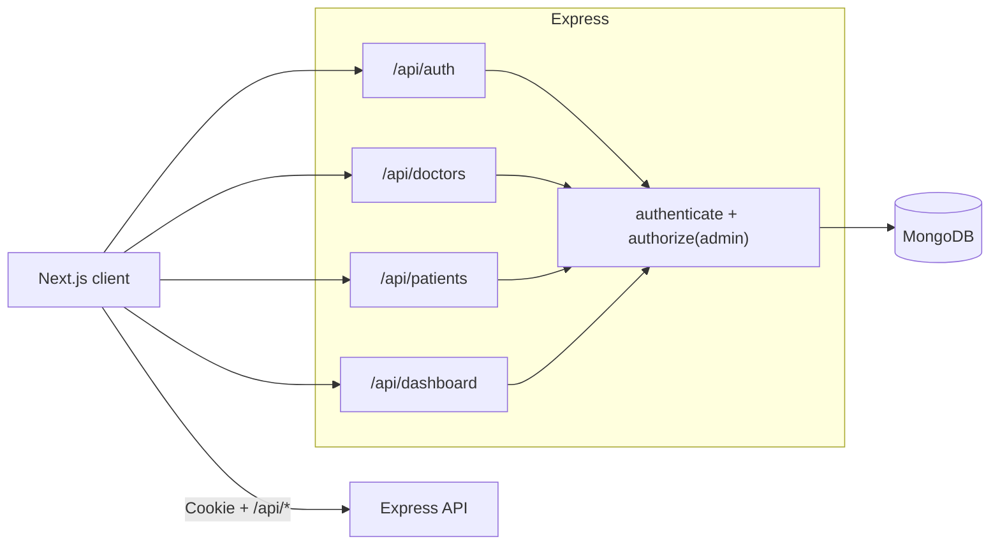

# Doctor Tracker API

Express + TypeScript + Mongoose backend for Doctor Tracker. It exposes JWT cookie auth, doctor/patient CRUD with search/filter/pagination, and MongoDB aggregation endpoints that power the clinic dashboard.

## Demo credentials

| Field    | Value               |
| -------- | ------------------- |
| Email    | `admin@example.com` |
| Password | `Admin@123`         |

Created by `npm run seed`.

## Setup Guide

### Prerequisites

- Node.js 20+
- MongoDB running locally (or a reachable MongoDB URI)

### 1. Install

```bash
cd backend
npm install
```

### 2. Environment

Copy `.env.example` to `.env`:

```env
PORT=5000
MONGO_URI=mongodb://127.0.0.1:27017/doctor-tracker
JWT_SECRET=change_me_to_a_long_random_secret
CLIENT_URL=http://localhost:3000
NODE_ENV=development
```

Notes:

- `CLIENT_URL` must match the Next.js origin (CORS + cookie credentials).
- Keep `JWT_SECRET` long and random in any shared or production environment.

### 3. Seed the database

```bash
npm run seed
```

Creates 1 admin, 30 doctors, and 300 patients. Indexes are also synced on API boot via `Model.syncIndexes()`.

### 4. Run

```bash
npm run dev
```

API listens on [http://localhost:5000](http://localhost:5000). Health check: `GET /api/health`.

### Scripts

| Script          | Purpose                |
| --------------- | ---------------------- |
| `npm run dev`   | API with hot reload    |
| `npm run seed`  | Reset + seed data      |
| `npm run build` | Compile TypeScript     |
| `npm start`     | Run compiled `dist/`   |

## System Architecture



### Request flow

1. Controllers parse/validate input with Zod.
2. Services own domain logic and Mongo queries (`.lean()`, projections, aggregations).
3. Models define schemas + indexes; middleware handles auth and centralized errors.

### Main routes

| Method | Path | Purpose |
| ------ | ---- | ------- |
| `POST` | `/api/auth/login` | Set httpOnly JWT cookie |
| `POST` | `/api/auth/logout` | Clear cookie |
| `GET` | `/api/auth/me` | Current admin session |
| `GET/POST` | `/api/doctors` | List (search/filter/page) / create |
| `GET` | `/api/doctors/:id` | Doctor detail |
| `GET/POST/DELETE` | `/api/doctors/:id/patients` | Nested patient list/create/delete |
| `GET/PATCH/DELETE` | `/api/patients` / `:id` | Global patient list/update/delete |
| `GET` | `/api/dashboard/stats?range=` | Aggregated KPIs + chart series |

## Technical Decisions

### 1. Layered Express modules instead of fat routes

Routes stay thin. Controllers only adapt HTTP ↔ Zod. Services own business rules and query shape. That keeps list/search logic testable and avoids duplicating filters across doctor vs patient endpoints.

Shared helpers in `src/utils/query.ts` standardize:

- pagination skip/meta
- inclusive `from`/`to` day bounds
- allow-listed sort parsing

### 2. Compound indexes + aggregations for list/analytics speed

List screens filter and sort on predictable fields, so indexes match those access patterns:

- **Doctor:** text(`name`, `specialization`, `hospital`); `{ createdAt: -1 }`; `{ specialization: 1, createdAt: -1 }`; `{ hospital: 1, createdAt: -1 }`
- **Patient:** text(`name`, `email`); `{ createdAt: -1 }`; `{ condition: 1, createdAt: -1 }`; `{ doctor: 1, createdAt: -1 }`; `{ doctor: 1, condition: 1, createdAt: -1 }`

List queries run `find` + `countDocuments` in parallel, project only needed fields, and prefer `textScore` when searching. Dashboard stats use parallel aggregation pipelines (`$dateTrunc`, `$group`, `$lookup`) so Node never loads full collections for charts.

## Project layout

```text
backend/
├── src/
│   ├── config/        env + Mongo connection
│   ├── models/        User, Doctor, Patient
│   ├── routes/        auth, doctors, patients, dashboard
│   ├── controllers/   HTTP adapters
│   ├── services/      domain + query logic
│   ├── validators/    Zod schemas
│   ├── middleware/    auth, errors
│   ├── utils/         AppError, JWT, query helpers
│   ├── seed.ts
│   └── server.ts
├── .env.example
└── package.json
```
